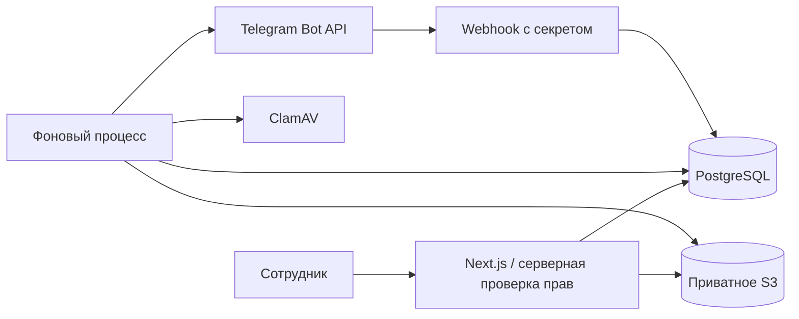
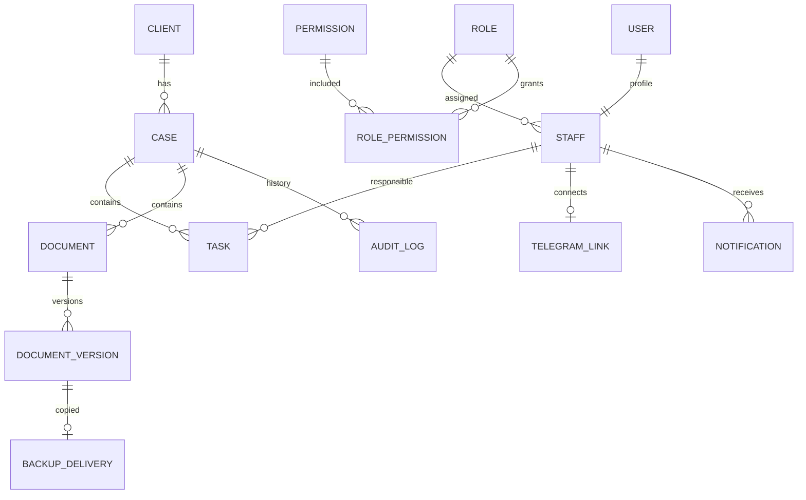

# Архитектура и рабочие правила

Next.js App Router, React, TypeScript и Tailwind CSS. Серверные операции используют PostgreSQL через pg. Авторизация — Better Auth с серверными сессиями, хешированием паролей и восстановлением через SMTP. Файлы — S3-совместимое приватное хранилище; проверки — ClamAV. Фоновые задания хранятся в PostgreSQL.

## Основные связи

У человека общие контакты, у каждого дела собственные документы, задачи и статус. Совпадение имени не объединяет людей. Контакты, затрагивающие недоступные сотруднику дела, может изменить менеджер с общим доступом.

Одна роль на сотрудника; роль — редактируемый набор permissions. Administrator защищён от удаления базовых прав. Employee видит дела, в которых он ответственный, escalation person или участник незавершённой задачи. Право действия не заменяет право доступа к конкретному делу. Авторство завершённой задачи не даёт постоянного доступа.

Задачи имеют три статуса; просрочка вычисляется отдельно. Общий срок дела и сроки задач выводятся совместно. Даты сохраняются в UTC, отображаются в часовом поясе компании. Дата без времени означает 18:00 местного времени. Рабочие календари не включены.

Номер версии защищён уникальным ограничением и блокировкой строки документа. Новый файл имеет новый ключ в storage и новый статус Uploaded. Статус проверки и срок действия раздельны. Скачивание через сервер проверяет доступ и записывает событие; постоянных публичных ссылок нет.

Фоновые задания создаются в той же транзакции, что и бизнес-операции. Уникальный ключ предотвращает повторное создание задания. После сбоя задания повторяются с увеличением задержки. Нельзя гарантировать ровно одну внешнюю отправку Telegram при потере ответа API — в этом случае возможен повтор сообщения.

Подключение Telegram одноразовое, срок ссылки 10 минут. Webhook проверяет секрет. Обновления Telegram сохраняются с уникальным ID; загрузки привязаны к сотруднику и делу, перед сохранением повторно проверяются права. Буфер получаемого файла ограничен.

Журнал действий неизменяем через приложение; SQL-триггер запрещает UPDATE/DELETE. Владелец сервера/суперпользователь PostgreSQL технически способен изменить структуру БД, поэтому в production нужны отдельные роли миграций и приложения и защищённые резервные копии.

## Эксплуатационные решения

- Compose публикует порты только на localhost. Для команды нужен выбранный вами HTTPS reverse proxy и домен.
- Производственные почта, Telegram, внешние резервные копии и хранилище требуют реквизитов владельца.
- Перед эксплуатацией подтвердить размещение данных, срок хранения копий, RPO/RTO и состав участников Backup Chat.
- Автоматическое окончательное удаление документов отсутствует. Архивирование обратимо.
- Для тестов используется PGlite с PostgreSQL-протоколом; это только изолированная проверка SQL, не замена PostgreSQL в рабочем запуске.
